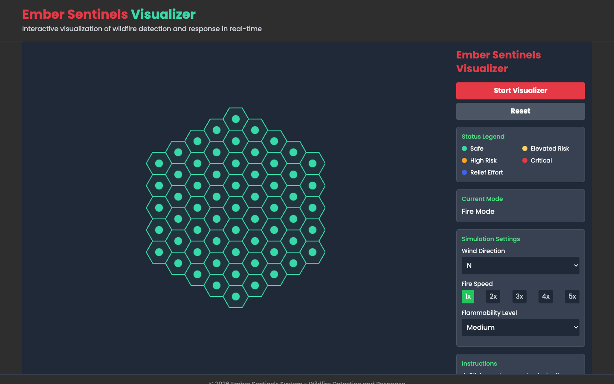

<p align="center">
  
</p>

# Ember Sentinels

Wildfire early-warning research built on materials science: hexagonal "Sentinel" stickers with chemochromic (VOC-reactive) and thermochromic layers that change color before a fire spreads. This repo is the project's main website.

**Visualizer (live):** <https://ember-sentinels-visualizer.vercel.app>

## Why

Wildfires are getting more frequent and more destructive, and most detection happens once smoke is already visible. Ember Sentinels asks whether cheap, passive materials placed across a landscape can signal risk earlier: stickers react to the gases and heat that come before a fire, towers watch clusters of stickers, and a dashboard reads the patterns so communities get warned sooner.

## What it does

- **Home, Problem and Solution** pages make the case for the system and explain how the pieces fit together.
- **Layer explorer:** an interactive breakdown of the sticker's three layers (active detection film, contrast layer, reflective substrate).
- **Color state explorer:** cycles a sticker through its states (normal green, elevated yellow, high orange, critical red, high-humidity blue) with a description of each.
- **Documentation:** a long-form research write-up and technical drawings.
- **Dashboard:** an embedded risk dashboard that reads sensor patterns across a grid.

The companion visualizer (linked above) is a hex-grid fire-spread simulation: set wind direction, fire speed and flammability, start a fire, and place relief efforts.

## Design

A clean science-fair product site (white pages, red calls to action, hexagons everywhere) paired with a dark "control room" for the simulation. The one system shared across both is the sensor-state ramp from green to red, plus blue for humidity. The research pages switch to a Tufte-style long form with a serif face and margin notes.

| | |
|---|---|
| Type | Inter 400–700 (site) · Palatino / Georgia (research pages) · Poppins (visualizer) |
| Color | `#C53030` scarlet (primary) · `#DD6B20` ember orange · `#38A169` forest green · `#E63946` / `#38D9A9` / `#2E2E2E` visualizer critical, safe, background |
| Motion | Framer Motion 0.8 s fade-up on scroll, 2.75 s sticker color cycle; visualizer uses CSS flicker, ripple and pulse keyframes |

## How it works

A React single-page app with React Router. The source lives in `Ember Sentinels Main Website/`; the visualizer and dashboard are separate apps.

**Stack:** React 18 · TypeScript · Vite · Tailwind CSS · Framer Motion · React Router

## My role

Founder of Ember Sentinels. I did the materials research and designed and built the website.

## Run locally

```bash
cd "Ember Sentinels Main Website"
npm install
npm run dev
```
